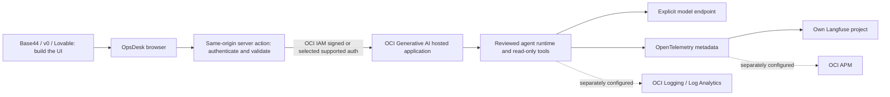

# One app, two places to look



This is the **target hosting architecture**, not evidence that a new builder app
was deployed. Builder coding-model activity and the runtime agent's model calls
are different systems; this instrumentation covers the runtime we control.

The local authored `/desk` reference runs in the existing loopback Studio server:
Browser → same-origin session API → native tool-call agent → selected model,
with private records and optional Langfuse export. No public credentials, cloud
endpoint, tunnel, hosted builder or CORS change is added by the reference.

The existing OCI sample runs the LangGraph/JSON coordinator. A builder server
adapter must normalize its API and enforce caller/session authorization; the
local native SSE API is not automatically interchangeable. Show that distinction
when discussing portability, rather than claiming every backend is a URL swap.

The [preview](diagrams/architecture.svg) is generated from a canonical
[JSON specification](diagrams/architecture.json), with editable
[Draw.io](diagrams/architecture.drawio), [Excalidraw](diagrams/architecture.excalidraw)
and [Mermaid](diagrams/architecture.mmd) sources. The OCI diagramming helper
validated these logical diagrams offline. Generic primitives are used; no official
service stencil fidelity or native editor rendering is asserted.

Regenerate using the installed helper, then rebuild the guide:

```sh
.venv/bin/python scripts/build_app_first_architecture.py \
  --builder /path/to/oci-diagramming/scripts/oci_diagram.py
.venv/bin/python scripts/build_app_first_workshop.py
```
