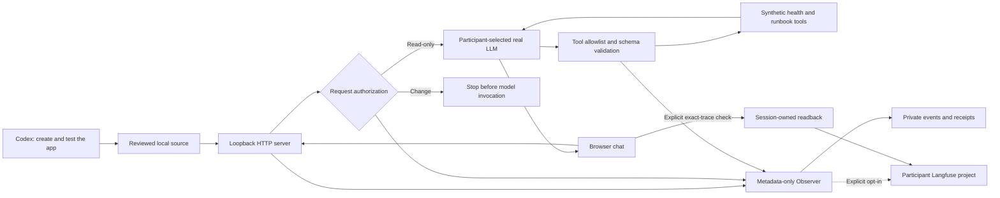

# Local chat architecture

Codex's coding account and the app's model credentials are separate. The coding
prompt creates or edits source; it is not the runtime tool executor. Model keys
and Langfuse keys stay on the server. The browser chooses only a configured alias.

Every chat turn gets a new trace and retains its conversation session. Tool output
is untrusted evidence. A model-generated tool name never expands the registry.
The server has no infrastructure mutation, credential-export or generic shell tool.

Export failure preserves local evidence and stays visible. Readback requires the
same trace/session, and another browser session cannot query that trace through
the studio. This is a loopback workshop app; it does not provide multi-user hosted
authentication, durable conversation storage or a hardened code-execution sandbox.

## Editable diagram set

| View | Preview | Editable sources |
|---|---|---|
| Coding and creation | [Creation](diagrams/01-creation.svg) | [Draw.io](diagrams/01-creation.drawio), [Excalidraw](diagrams/01-creation.excalidraw), [Mermaid](diagrams/01-creation.mmd) |
| Runtime loop and app | [Runtime](diagrams/02-runtime.svg) | [Draw.io](diagrams/02-runtime.drawio), [Excalidraw](diagrams/02-runtime.excalidraw), [Mermaid](diagrams/02-runtime.mmd) |
| Authorization and validation | [Security](diagrams/03-security.svg) | [Draw.io](diagrams/03-security.drawio), [Excalidraw](diagrams/03-security.excalidraw), [Mermaid](diagrams/03-security.mmd) |
| Local record, delivery and readback | [Telemetry](diagrams/04-telemetry.svg) | [Draw.io](diagrams/04-telemetry.drawio), [Excalidraw](diagrams/04-telemetry.excalidraw), [Mermaid](diagrams/04-telemetry.mmd) |

Canonical JSON specs and hashes live beside these files. Regenerate with
`scripts/build_studio_diagrams.py --builder /path/to/oci_diagram.py`, then
`scripts/build_studio_workshop.py`. The OCI diagramming helper validates the
editable formats; these drawings use generic shapes. They describe source/design,
not deployed topology, official service glyph placement or provider acceptance.

The `--learner-agent` lane replaces the runtime core with reviewed participant
code while retaining the server-owned transport and HTTP/session controls.
Its tool list comes from that core. The minimal learner has one health tool;
runbook/failure tools and finer spans are explicit later exercises. Neither the
shell nor this diagram claims those capabilities were created automatically.

OCI APM and Log Analytics remain a later integration path from the shared
Observer. This local edition currently validates Langfuse opt-in and private
metadata records; it does not claim that every local turn is ingested into OCI.
